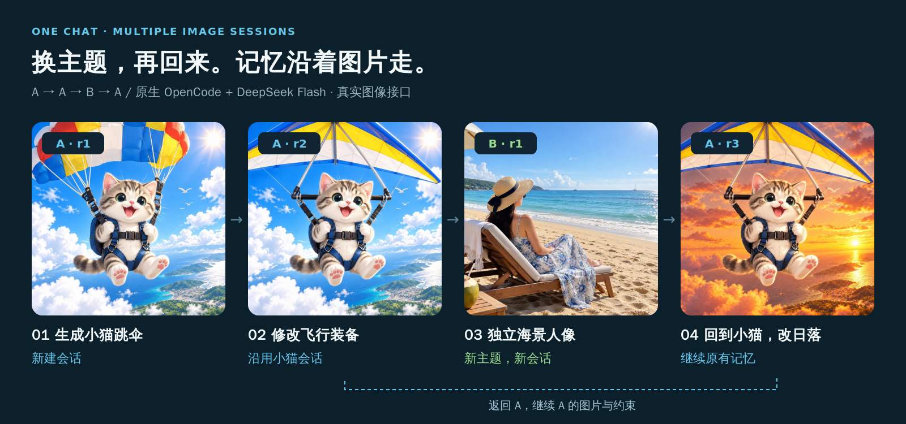

# 米醋画图 MCP

[简体中文](README.md) · [English](README.en.md)

把 [米醋](https://www.micuapi.ai) 的图像接口接入 Claude Code、Claude Desktop、Codex、Cursor 等 MCP 客户端，支持生成图片、连续编辑、批量编辑和多图参考。

连续编辑时，MCP 保存图片版本、成功指令和有效约束。沿用同一个会话 ID，就能在上一版图片上继续修改；不同主题使用各自的会话。


[安装](#安装) · [连续编辑](#上下文记忆) · [模型与质量](#模型与质量) · [尺寸规则](#尺寸规则) · [调试与验证](#调试与验证) · [v0.4.3 发布说明](https://github.com/Subaru486desuwa/micu-image-mcp/releases/tag/v0.4.3)

## 上下文记忆

先生成一只小猫，再修改它的飞行装备。中途可以另开会话生成海景，之后回到小猫会话，把背景改成日落。
客户端传入对应的会话 ID，MCP 就会携带该版本的图片、成功编辑历史和有效约束。



| 你说的话 | 图片会话 | MCP 的处理 |
| --- | --- | --- |
| “生成一只小猫跳伞。” | A · r1 | 建立新会话，保存首张图和描述 |
| “给它换一种飞行装备。” | A · r2 | 上传 A 的上一版图片，携带主角要求和有效约束 |
| “另外生成一张独立海景人像。” | B · r1 | 新建 B，使用这个主题自己的图片与约束 |
| “回到刚才的小猫，把背景改成日落。” | A · r3 | 返回 A，从 A 的成功历史继续编辑 |

这四张图来自 2026-10-09 在 Osaka 上通过 OpenCode、DeepSeek Flash 和本项目调用米醋主站的验收。
海景请求失败一次，调整提示后重试成功，失败没有推进会话版本。第二张实际画出了硬质滑翔翼；
随后人工补充软翼形态约束，得到海报使用的 A · r4。海报与四步图分别标明版本，完整来源见[配图说明](docs/assets/memory/README.md)。

### 记忆如何接上下一轮

1. 首次生成或编辑时，给 `image_generate` 或 `image_edit` 传入 `session_id="new"`，由客户端保存返回的 `session.id`。生成会话要求 `n=1`。
2. 继续修改时，传入原 ID 和本轮指令。省略 `model`、`size`、`quality` 时继承所选版本的参数；MCP 上传该版本图片并携带其编辑上下文。
3. 新主题使用 `"new"`，回到旧图使用原 ID。上图的 `A`、`B` 是简称，实际 ID 形如 `edit_<32位十六进制>`。
4. 会话保存在运行 MCP 的电脑上。重启后保留原 ID、输出根目录和对应图片，即可继续。指定 `parent_revision` 可从旧版本创建分支。

客户端或模型负责选择会话，MCP 按传入的 ID 读取记录，不会自动接收完整聊天历史。
省略 `session_id` 时按单次调用处理，不保存会话。图片成功保存并提交会话记录后才推进版本；同一会话正在修改时，另一调用会返回忙。
支持范围和存储管理见[连续编辑指南](docs/multi-turn-editing.md)和[会话存储说明](docs/session-storage.md)。

[下载海报 PNG](docs/assets/memory/context-memory-poster.png) · [可编辑 SVG](docs/assets/memory/context-memory-poster.svg) · [四步示例大图](docs/assets/memory/four-turn-demo.png)

---

## 功能

| 工具 | 说明 |
|---|---|
| `image_generate` | 根据文字生成图片，默认 Flare；传入已有会话 ID 时继续编辑 |
| `image_edit` | 根据一张参考图和指令编辑图片，默认 Sunburst，支持蒙版 |
| `image_batch_edit` | 对多张图片分别应用同一条指令，默认 Sunburst 串行处理 |
| `image_multi_reference` | 同时参考 2 到 10 张图片生成一张新图，默认 Sunburst |
| `server_info` | 查看当前版本、接口地址、模型、尺寸规则、重试策略和安全限制 |

第一次使用前，让客户端调用 `server_info`，确认当前配置和工具能力。

---

## 使用教程

Cursor、Claude Code 和 Codex 的配置与使用方法见 [MCP 使用教程](docs/MCP使用教程.md)，
包括工具选择、尺寸规则、环境变量，以及 Clash/Surge fake-ip 导致的图片下载问题。

---

## Claude Desktop 兼容性

v0.4.1 已修复 [issue #11](https://github.com/Subaru486desuwa/micu-image-mcp/issues/11) 的 `Connected · 0 tools`。
升级客户端实际启动的程序，重新连接 MCP，再调用 `server_info` 确认版本。

Desktop 的 Code 模式读取 `~/.claude.json`；普通 Chat 模式使用独立的 `claude_desktop_config.json`，
当前安装器不会自动写入后者。[兼容性指南](docs/claude-desktop-compatibility.md)包含根因、两种模式的配置和测试范围。

---

## 模型与质量

四个图像工具都接受 `gpt-image-2.5-flare-openai`、`gpt-image-2.5-sunburst`、`gpt-image-2` 和 `gpt-image-2-openai`。
文生图默认 Flare，编辑、批量编辑和多图参考默认 Sunburst。实际可用模型以当前凭据访问 `/v1/models` 的结果为准。
旧 ID `gpt-image-2.5-flare` 自动映射到 `gpt-image-2.5-flare-openai`，已有 `MICU_MODEL` 配置和图片会话可继续使用。
Flare 的 Images 请求不发送 `response_format`，直接保存上游返回的 base64 或 URL 图片。下载或响应解析失败时，不通过更换格式重复提交生图请求。所有图像工具只走 `/v1/images/generations` 或 `/v1/images/edits`，不调用 Responses API。

2026-10-16，v0.4.3 Release 候选在米醋主站完成默认 Flare 生图与重启后的会话编辑，两次 Images 请求均返回 HTTP 200 和 1024×1024 图片，均省略 `quality` 与 `response_format`。

2026-10-09 米醋主站的 1K 生成与单图编辑实测结果如下。

| 模型 | 实测可用的 `quality` | 限制 |
| --- | --- | --- |
| Flare / Sunburst | `low`、`auto` 或省略 | `medium`、`high`、`xhigh`、`max` 返回 HTTP 400，上游提示只支持 `low` |
| `gpt-image-2` | `low`、`medium`、`high`、`auto` 或省略 | 2K/4K 会自动切换到 `gpt-image-2-openai`，需确认凭据支持该模型 |
| `gpt-image-2-openai` | 未验证 | 当次凭据的模型列表未包含该模型 |

完整记录见[在线质量档位验证](docs/session-storage.md#在线质量档位验证)。这些结果对应当时的线路和凭据，Flare 使用改名前的 ID。
工具保留完整参数选项，以兼容其他线路或后续支持；尺寸路由见[尺寸规则](#尺寸规则)。
Grok 实现保留但暂时禁用，工具会拒绝相关模型。

---

> MCP 使用 UTF-8 JSON 发送中文。自行编写 PowerShell 测试脚本时，先设置 `$OutputEncoding = [Console]::OutputEncoding = [System.Text.UTF8Encoding]::new()`，避免旧 PowerShell 在管道中把中文变成 `?`。

## 安装

本项目使用 Rust 单文件程序，无参数运行即启动 STDIO MCP 服务，不需要 Python。
`main` 的产品代码、测试和工程工具均由 Rust 维护；历史 Python 实现保留在
[`python-reference`](https://github.com/Subaru486desuwa/micu-image-mcp/tree/python-reference) 分支，不参与当前构建或发布。

### 一键安装（推荐）

macOS / Linux：

```bash
curl -fsSL https://raw.githubusercontent.com/Subaru486desuwa/micu-image-mcp/main/scripts/install.sh | sh
```

Windows PowerShell：

```powershell
irm https://raw.githubusercontent.com/Subaru486desuwa/micu-image-mcp/main/scripts/install.ps1 | iex
```

脚本识别当前平台，从最新 GitHub Release 下载程序，用该 Release 的 `SHA256SUMS` 校验后执行 `install --yes`。
安装器默认写入 Codex 和 Claude Code 的 `micu-image` 配置，Claude Code 使用 `~/.claude.json`。
Claude Desktop 普通 Chat 模式需要[单独配置](docs/claude-desktop-compatibility.md)。

API key 不写入客户端配置文件。安装器先检查 `MICU_API_KEY` 和系统安全凭据存储；首次安装且都未配置时，
在交互式终端中提示输入一次，输入内容不回显。通过 `sk-` 前缀、20 到 512 字符长度和 ASCII 字符集校验后，
安装器将其存入 macOS Keychain、Windows Credential Manager 或 Linux Secret Service，供 MCP 启动时读取。
默认接口地址为 `https://www.micuapi.ai`；自定义地址使用 `--baseurl` 或 `MICU_BASEURL`。

macOS / Linux 上只配置 Codex 时，给安装器传入 `--no-claude`：

```bash
curl -fsSL https://raw.githubusercontent.com/Subaru486desuwa/micu-image-mcp/main/scripts/install.sh \
  | sh -s -- --no-claude
```

脚本源码在 [`scripts/install.sh`](scripts/install.sh) 和
[`scripts/install.ps1`](scripts/install.ps1)，可先审阅再执行。

### 手动下载程序

从 [最新 Release](https://github.com/Subaru486desuwa/micu-image-mcp/releases/latest) 下载平台对应文件并
核对 `SHA256SUMS`：

```bash
chmod +x /absolute/path/micu-image-mcp   # macOS/Linux
MICU_SAVE_DIR="$HOME/Pictures/micu-out" \
/absolute/path/micu-image-mcp install --yes
```

`install` 将程序复制到当前用户的固定安装目录，并让 Codex 和 Claude Code 使用该副本。
移动源码仓库或执行 `cargo clean` 不影响已安装的 MCP。

- macOS：`~/Library/Application Support/micu-image-mcp/bin/micu-image-mcp`
- Linux：`~/.local/share/micu-image-mcp/bin/micu-image-mcp`
- Windows：`%LOCALAPPDATA%\micu-image-mcp\bin\micu-image-mcp.exe`

常用命令：

```bash
micu-image-mcp                 # 等同 serve，STDIO MCP
micu-image-mcp serve
micu-image-mcp install --yes --no-claude
micu-image-mcp install --yes --binary-path /path/to/downloaded/binary
micu-image-mcp install --yes --dev --binary-path "$PWD/target/release/micu-image-mcp"
micu-image-mcp reset --yes
micu-image-mcp doctor
micu-image-mcp version
```

### 从源码构建

需要 Rust 1.88 或更新版本。Linux ARM64 等没有预编译包的平台也使用此方式。
源码开发时，可让客户端直接使用编译产物：

```bash
cargo build --release
MICU_SAVE_DIR="$HOME/Pictures/micu-out" \
target/release/micu-image-mcp install --yes --dev \
  --binary-path "$PWD/target/release/micu-image-mcp"
```

### macOS Keychain

程序启动时按 service/account 从 macOS Keychain 读取 API key。已有自定义 Keychain 项时，
让 `MICU_KEYCHAIN_SERVICE` 和 `MICU_KEYCHAIN_ACCOUNT` 与该项一致。下例手动创建凭据项并配置 Codex：

```bash
security add-generic-password \
  -U -a "$USER" -s ai.micuapi.mcp \
  -l "Micu Image MCP API Key" \
  -T /usr/bin/security -w
```

```toml
[mcp_servers.micu-image]
command = "/Users/you/Library/Application Support/micu-image-mcp/bin/micu-image-mcp"
args = []

[mcp_servers.micu-image.env]
MICU_KEYCHAIN_SERVICE = "ai.micuapi.mcp"
MICU_KEYCHAIN_ACCOUNT = "your-macos-account"
MICU_SAVE_DIR = "/Users/you/Pictures/micu-out"
MICU_SAVE_DIR_ROOT = "/Users/you/Pictures/micu-out"
```

Codex 桌面、CLI 和 IDE 扩展共享 `~/.codex/config.toml`；修改后重启客户端。

### 验证与回滚

安装后让客户端调用 `server_info`，确认版本、`available_models`、接口地址、输出根目录和 `api_key_configured`。
也可在终端检查配置，或从源码仓库运行离线 MCP 检查：

```bash
micu-image-mcp doctor
cargo xtask smoke --binary /absolute/path/micu-image-mcp
```

回滚安装变更时，恢复可信程序和安装器生成的配置备份，保留图片和会话。完整说明见
[迁移与回滚](docs/migration-from-python.md)，开发、测试和工程工具见
[Rust-only 开发](docs/rust-only-development.md)。

---

## 尺寸规则

四个支持的模型均使用以下尺寸校验：

- 宽和高必须是 16 的倍数。
- 每条边在 256 到 3840 之间，长宽比不超过 3:1。
- 总像素在 655,360 到 8,294,400 之间。

路由与并发处理如下。

- 单图编辑、批量编辑和多图参考使用 `/v1/images/edits`。
- `gpt-image-2` 的 2K/4K 请求自动切换到 `gpt-image-2-openai`。
- Flare / Sunburst 的 2K/4K 请求保持所选模型。
- 2K/4K 生成请求强制 `n=1`，高分辨率请求通过进程内与跨进程锁串行访问队列。

实际保存尺寸以每张图片的 `saved.actual_size` 为准，生成工具的 `saved` 是列表。

常用 `size` 值：

| 档位 | 推荐值 |
|---|---|
| 1K | `1024x1024`, `1280x720`, `720x1280`, `1024x1536`, `1536x1024` |
| 2K | `2048x2048`, `2048x1152`, `1152x2048` |
| 4K | `3840x2160`, `2160x3840` |

---

## 环境变量

| 变量 | 默认值 | 说明 |
|---|---|---|
| `MICU_API_KEY` | 空 | 米醋 Image2 通道的 API key |
| `MICU_BASEURL` | `https://www.micuapi.ai` | 图像接口地址 |
| `MICU_KEYCHAIN_SERVICE` | `micu-image-mcp` | 系统安全凭据的 service 名称 |
| `MICU_KEYCHAIN_ACCOUNT` | `image2-api-key` | 系统安全凭据的 account 名称 |
| `MICU_MODEL` | 空 | 可选全局覆盖；未设置时生成默认 Flare，编辑类默认 Sunburst |
| `MICU_SAVE_DIR` | `~/Pictures/micu-out` | 默认输出目录 |
| `MICU_SAVE_DIR_ROOT` | 同输出目录 | 输出安全根目录 |
| `MICU_INPUT_ROOT` | 空（不限制） | 可选输入图片白名单根；启用后阻止路径/符号链接逃逸 |
| `MICU_USE_SHELL_PROXY` | `0` | 设为 `1` 才读取进程环境中的代理设置 |
| `MICU_RESPONSE_FORMAT` | `auto` | 旧模型可选 `auto`、`url`、`b64_json`；Flare 不发送此参数，按上游返回保存 |
| `MICU_TRUSTED_DOWNLOAD_HOSTS` | `oss.filenest.top` | 可信下载域名，逗号分隔 |
| `MICU_ALLOW_FAKE_IP_DOWNLOAD` | `1` | 仅允许可信域名使用 198.18.0.0/15 fake-ip 下载 |

路径基准在 MCP 启动时确定。相对 `MICU_SAVE_DIR` 和工具的 `save_dir` 以输出根目录为基准；
设置 `MICU_INPUT_ROOT` 时，相对输入路径以该目录为基准，否则以启动时的工作目录为基准。
路径只展开 `~`、`~/...` 和 Windows 的 `~\...`，拒绝 `~someone`。

## 手动配置

Claude Code 使用以下 JSON 配置：

```json
{
  "mcpServers": {
    "micu-image": {
      "command": "/absolute/path/micu-image-mcp",
      "args": [],
      "env": {
        "MICU_SAVE_DIR": "/Users/you/Pictures/micu-out",
        "MICU_SAVE_DIR_ROOT": "/Users/you/Pictures/micu-out"
      }
    }
  }
}
```

Codex 使用以下 TOML 配置：

```toml
[mcp_servers.micu-image]
command = "/absolute/path/micu-image-mcp"
args = []

[mcp_servers.micu-image.env]
MICU_SAVE_DIR = "/Users/you/Pictures/micu-out"
MICU_SAVE_DIR_ROOT = "/Users/you/Pictures/micu-out"
```

将 `command` 替换为实际程序路径，并按需调整输出目录。Windows 路径建议用 TOML 单引号字符串，
例如 `'C:\Users\you\AppData\Local\micu-image-mcp\bin\micu-image-mcp.exe'`；使用双引号时必须转义反斜杠。
安装器会处理路径转义并校验配置。

上述 JSON/TOML 不保存 API key。凭据由 MCP 进程环境、系统安全凭据存储或工具的 `api_key` 参数提供。

---

## 调试与验证

当前主线使用 Rust 离线测试，通过真实 MCP STDIO 和本地 HTTP 替身检查工具协议、请求参数、
图片下载、路径限制、会话恢复、失败处理和安装配置。离线测试不产生图像费用，不能代替实际图片的视觉验收。
完整检查命令见 [Rust-only 开发与验收](docs/rust-only-development.md)。

v0.4.1 发布时的调试和验收记录见[v0.4.1 调试笔记](docs/v0.4.1-debugging-notes.md)、
[原生客户端验收](docs/harness-validation.md)、
[当时的完整 CI](https://github.com/Subaru486desuwa/micu-image-mcp/actions/runs/37884013213)和
[发布流程](https://github.com/Subaru486desuwa/micu-image-mcp/actions/runs/37884913631)。
这些历史记录包含迁移前的 Python 测试和性能数据，不代表当前主线的测试数量或最新平台验证结果。
该轮 MacBook 的五工具、协议与 `server_info` 检查通过，Claude Desktop 窗口生图验收仍需由用户完成。

---

## 工程与验证文档

实现说明和验证记录：

- [Rust-only 开发与验收](docs/rust-only-development.md)
- [Rust / Python 历史性能基准](docs/rust-benchmark.md)
- [v0.4.1 调试笔记](docs/v0.4.1-debugging-notes.md)
- [原生 harness 验收与耗时优化](docs/harness-validation.md)
- [Rust 兼容性矩阵](docs/rust-compatibility-matrix.md)
- [安全审计](docs/rust-security-review.md)
- [Python → Rust 迁移与回滚](docs/migration-from-python.md)
- [贡献与本地验证](CONTRIBUTING.md)

## Star history

[](https://star-history.com/#Subaru486desuwa/micu-image-mcp&Date)
